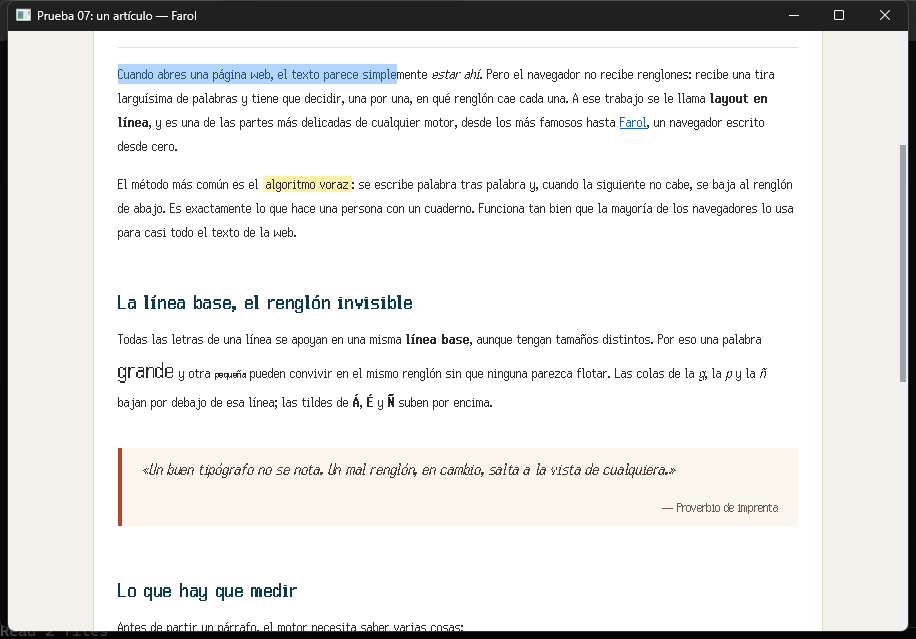

# Bitácora — Extra: scroll, selección y copiar

Fecha: 2026-11-18. Adelantado de la fase 11 a pedido del arquitecto.

## Qué se construyó

- **Scroll:** rueda del mouse, flechas, AvPág/RePág, Espacio (Shift+Espacio sube), Inicio/Fin.
  Barra gris a la derecha cuyo tamaño dice qué parte de la página se ve.
- **Selección:** arrastrar, doble clic (palabra), Shift+clic (extender), Ctrl+A (todo),
  Escape (quitar). El cursor cambia a "I" sobre el texto.
- **Copiar:** Ctrl+C pone el texto en el portapapeles de Windows, con saltos de línea entre
  párrafos.
- 15 pruebas nuevas (213 en total). Verificado simulando mouse y teclado y leyendo el
  portapapeles: el doble clic copió `algoritmo` y el arrastre `Cuando abres una página web, el
  texto parece simple`.

## Conceptos nuevos

- **El scroll no mueve la página.** Es como una hoja larga detrás de una ventana de papel: bajar
  es correr la hoja hacia arriba. Farol pinta la página restándole a cada `y` cuánto se bajó.
- **La rueda habla en "muescas".** Cada clic de la rueda que sientes con el dedo llega como una
  "línea" (120 unidades en Windows). Farol la convierte en 48 pixeles. Un touchpad, en cambio,
  manda pixeles directamente.
- **Saber qué letra hay bajo el mouse (*hit testing*).** El layout ya sabe dónde está cada
  pedazo de texto. Para encontrar la letra exacta se mide el texto letra por letra desde el
  inicio del pedazo hasta pasar la `x` del mouse, como contar baldosas con el pie.
- **El doble clic no existe para el sistema.** Windows manda dos clics sueltos; Farol los junta si
  llegan en menos de medio segundo y a menos de 4 pixeles uno del otro.
- **El azul es transparente.** El resaltado es un rectángulo azul al 38 % pintado encima de todo:
  cada pixel mezcla el color de abajo con el azul, por eso el texto se sigue leyendo.
- **El portapapeles es un trámite con Windows.** Se pide memoria que Windows pueda guardar, se
  escribe el texto en UTF-16 (el formato de texto de Windows) y se le entrega. Desde ahí esa
  memoria es de Windows: si Farol se cierra, lo copiado sigue ahí.
- **Un *trait* como contrato.** `ui::Pagina` dice qué debe saber hacer algo para mostrarse en la
  ventana, igual que una interfaz en TypeScript. La ventana no sabe nada de HTML.

## Lo que salió mal

- El primer código de eventos no compilaba por un préstamo doble en Rust (se pedía la ventana
  prestada y a la vez se llamaba un método que también la necesitaba); se separó el repintado en
  su propia función.
- En la primera prueba automática el doble clic "no funcionaba": la culpa era de la prueba, que
  movía el cursor y hacía clic en el mismo instante, antes de que Farol se enterara de dónde
  estaba el mouse. Con una pausa después de mover el cursor, funcionó.
