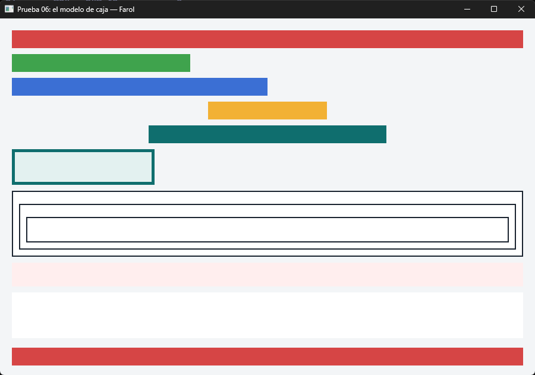
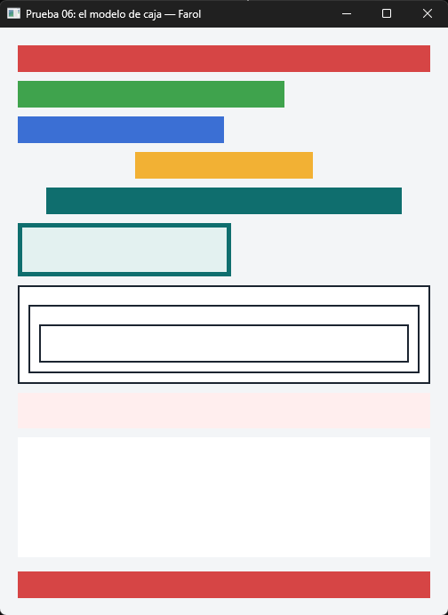
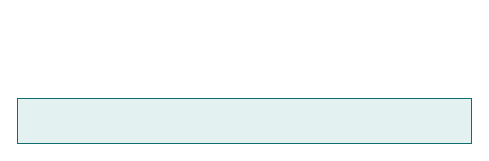

# Bitácora — Fase 6: pintado y display list

Fecha: 2026-11-18. Estado: cerrada.

## Qué se construyó

- `src/pintado/lista.rs`: la **display list**. Recorre el árbol de cajas y escribe una lista de
  órdenes (`Orden::FondoDelLienzo`, `Orden::Rectangulo`): por cada caja su fondo, sus cuatro
  bordes y después sus hijos. Lo transparente no genera orden.
- El **fondo del lienzo** (CSS 2.1 §14.2): el fondo de `html`, o el de `body` si el de `html` es
  transparente, cubre toda la ventana; si ninguno tiene, blanco.
- `src/pintado/rasterizar.rs`: `Lienzo::ejecutar` convierte las órdenes en pixeles. Redondea las
  coordenadas sin dejar huecos, convierte `css::Color` a `0x00RRGGBB` y mezcla los colores
  semitransparentes con lo que hay debajo (decisión 6.1). `ejecutar_desplazado` ya acepta un
  scroll vertical para la fase 11.
- `src/pintado/bmp.rs`: un escritor de archivos BMP hecho a mano, byte a byte (decisión 6.2).
- `farol <archivo.html>`: abre la página en la ventana. El título es el `<title>` + " — Farol".
  Al redimensionar, el layout se recalcula con el ancho nuevo.
- `farol --render <archivo.html> <salida.bmp> [ancho [alto]]`: la página como imagen, sin ventana.
- `ui::abrir` ahora recibe un **cierre** en vez de una función fija, para que la página viaje
  dentro de él. Las escenas de antes (`farol`, `farol --fuente`) siguen igual.
- Los comandos pasaron de `main.rs` a `src/comandos.rs`; `main.rs` solo reparte los argumentos.
- 16 pruebas automáticas nuevas (178 en total).

## Hito

Por primera vez una página HTML con CSS se ve en la ventana de Farol: cajas de colores, todavía
sin letras (el texto llega en la fase 8).

`farol pruebas/06-cajas.html`, la ventana a 900 px de ancho:

La misma ventana angostada a 500 px: los bloques `auto` y en `%` se encogen, los de ancho fijo no,
y los centrados se vuelven a centrar. El layout se rehízo con el ancho nuevo.

`farol --render pruebas/01-hola.html hola.bmp`: el `h1` y los párrafos no se ven (son solo texto,
sin fondo), pero la `.caja` sí: fondo `#e3f1f0` y borde `#0f6e6e` de 2 px, de x = 28 a 772, como
dicen las cuentas (8 del `body` + 20 de margen).

## Conceptos nuevos

- **Por qué se separa el layout del pintado.** Es lo mismo que separar la lógica del render en
  un frontend: en React calculas el estado y después el render lo convierte en DOM. Aquí el
  layout calcula *dónde* va cada caja (números), y el pintado decide *cómo se ve* (pixeles). Entre
  los dos queda la **display list**, que es como un guion: "rectángulo `#e3f1f0` de (30, 162) a
  (770, 233); rectángulo `#0f6e6e`…". Ese guion se puede probar sin mirar una sola imagen, y el
  día que se quiera pintar con la tarjeta de video se cambia solo quien lo ejecuta.
- **Rasterizar: de figuras a cuadritos.** Mira tu monitor con una lupa: es una cuadrícula de
  pixeles, y cada uno es un cuadrito entero, no hay "medio pixel". Pero el layout dice cosas como
  "la caja empieza en x = 28.5". Rasterizar es decidir qué cuadritos pinta cada figura. Farol
  redondea cada **arista** al entero más cercano (no el ancho): si el fondo termina en 30.5 y el
  borde empieza en 30.5, los dos redondean a 31 y no queda ni una rendija blanca entre ellos. Si
  redondeara el ancho, los errores se acumularían y aparecerían líneas de 1 px sueltas.
- **El orden de pintado son capas de pintura.** Pintar un cuadro es tapar lo de abajo con lo de
  arriba. Por eso el orden es: primero todo el lienzo (el fondo de la página), después, caja por
  caja como aparecen en el HTML, su fondo, su borde y por último sus hijos. Un hijo siempre queda
  encima del fondo de su padre, igual que en el navegador (sin `z-index`, que es otra historia).
- **El fondo del `body` pinta toda la ventana.** Si le pones `background: gris` al `body`, en
  Chrome se pinta toda la ventana, aunque el `body` mida 100 px de alto. Es una regla especial de
  CSS: el fondo del elemento raíz (o el del `body`, si el raíz no tiene) se "sube" al lienzo
  entero. Farol la cumple con una orden aparte (`FondoDelLienzo`) que va primero, y ese elemento
  ya no pinta su fondo en su caja, para no pintarlo dos veces.
- **La mezcla alfa: papel celofán.** Un color con alfa 50 % es como un celofán rojo puesto sobre
  un papel blanco: ves rosado. La cuenta es por canal (rojo, verde, azul): `resultado = fondo +
  (color − fondo) × alfa / 255`. Rojo al 50 % sobre blanco: el rojo queda en 255, el verde baja
  de 255 a 127 y el azul también: `#FF7F7F`, rosado (alfa 0.5 se guarda como 128 de 255). Tu pantalla no tiene transparencia de verdad
  (cada pixel es una luz con un solo color), así que la mezcla se hace antes, en la memoria.
- **Un archivo BMP por dentro, byte a byte.** Un BMP es casi la memoria cruda del lienzo con una
  etiqueta pegada adelante. Los primeros 2 bytes son las letras `BM` (la firma: "soy un BMP").
  Siguen 4 bytes con el tamaño del archivo y, en el byte 10, dónde empiezan los pixeles (54).
  Desde el byte 14 viene una segunda ficha de 40 bytes: ancho, alto, 24 bits por pixel, sin
  compresión. Y desde el byte 54, los pixeles: 3 bytes por pixel, en orden **azul, verde, rojo**
  (al revés de `#RRGGBB`), con dos rarezas: las filas van **de abajo hacia arriba** (herencia de
  cuando el origen de las coordenadas estaba abajo, como en matemáticas) y cada fila se rellena
  con ceros hasta un múltiplo de 4 bytes (a los procesadores viejos les gustaba leer de 4 en 4).
  Los números de varios bytes van en *little endian*: el byte menos significativo primero
  (78 se escribe `4E 00 00 00`).
- **Cierres en Rust (`FnMut`).** Antes la ventana recibía una función fija (`fn`), que no puede
  llevar datos consigo. Ahora recibe un **cierre**: una función que se lleva variables de
  afuera, como una función flecha de JavaScript que usa una variable del componente. `move`
  quiere decir que el cierre se queda con esos datos (el árbol estilado de la página); `FnMut`,
  que puede llamarse muchas veces y modificar lo que lleva. Así `ui` sigue sin saber qué es una
  página: solo sabe "cuando haya que repintar, llamo a esto".
- **Qué se calcula una vez y qué en cada repintado.** Leer el HTML, armar el DOM y la cascada no
  dependen del tamaño de la ventana: se hacen una vez al abrir. El layout sí depende (un `width:
  50%` cambia), así que se rehace cada vez que la ventana cambia de tamaño, igual que un
  navegador hace *reflow* al redimensionar.

## Decisiones

- 6.1 (opaco con mezcla alfa simple) y 6.2 (BMP con escritor propio), delegadas a Claude; no
  entró ninguna dependencia nueva.
- Ajustes al contrato de `pintado` (detalles internos, documentados en `docs/ARQUITECTURA.md`):
  la orden `FondoDelLienzo`, `ejecutar_desplazado` para el scroll, `bmp::codificar`, y
  `ui::abrir` con un cierre.

## Lo que salió mal o quedó pendiente

- Nada falló en las pruebas. Al ordenar el código, un `rustfmt` dejó el armado de los cuatro
  bordes en 30 líneas ilegibles; se reescribió con una función `entre(x0, y0, x1, y1)` que arma
  cada lado desde las aristas de los dos rectángulos. De paso eso garantiza que la arista interior
  del borde sea *exactamente* la del fondo.
- Las pruebas de la display list tuvieron que envolver el HTML en `<html>`: el parser no inventa
  esa etiqueta y, sin ella, el primer `div` hacía de raíz y su fondo cubría todo el lienzo. Quedó
  anotado como deuda junto con la de la fase 2.
- Comparando con Chrome: las cajas coinciden en `x` y en ancho; en `y` Farol queda más abajo
  porque no colapsa márgenes (deuda de la fase 5). En `01-hola.html` la `.caja` empieza en
  y = 160; en Chrome, más arriba.
- Deudas anotadas en `DECISIONES.md`: los elementos en línea no pintan fondo ni borde (fase 8),
  esquinas del borde sin corte en diagonal, sin `border-radius`/sombras/`opacity`, `html` y `body`
  reconocidos por posición, sin escalado por DPI, layout completo en cada repintado y sin scroll.
- Para probar: abre `farol pruebas/06-cajas.html` y arrastra el borde de la ventana: la barra
  azul (`width: 50%`) se estira y la amarilla (`width: 200px`) se mantiene centrada. O cambia en
  `pruebas/01-hola.html` el `background-color` del `body` por `rgba(255, 0, 0, 0.5)` y corre
  `farol --render pruebas/01-hola.html hola.bmp`: toda la imagen sale rosada (`#FF7F7F`).
