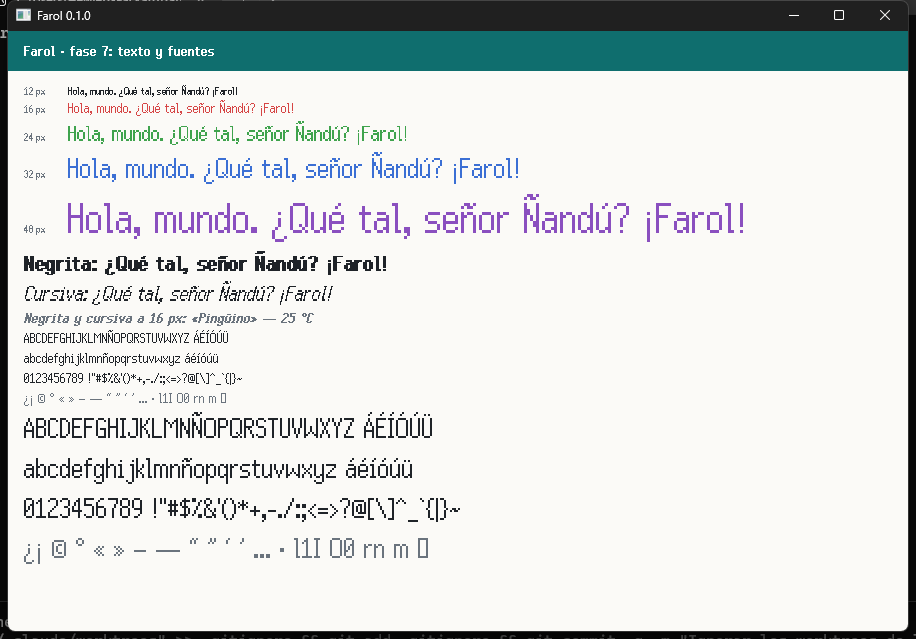

# Bitácora — Fase 7: texto y fuentes

Fecha: 2026-11-18. Estado: cerrada.



## Qué se construyó

- `src/pintado/fuente/glifos.txt`: 110 letras y signos (más el tofu) dibujados a mano con `#` (tinta) y `.`
  (vacío). Cubre todo el ASCII imprimible, los signos del español (¿ ¡) y `© ° « » – — “ ” ‘ ’ … ·`.
- `src/pintado/fuente/mod.rs`: lee esos dibujos una sola vez, arma las letras con tilde
  (á é í ó ú Á É Í Ó Ú ñ Ñ ü Ü), mide texto y lo escribe en el `Lienzo` a cualquier tamaño, en
  negrita y en cursiva. Un carácter que no está dibujado sale como un rectángulo hueco ("tofu").
- `src/pintado/fuente/demostracion.rs` y `farol --fuente`: la escena del hito.
- 15 pruebas automáticas nuevas (39 en total).

## Hito

`cargo run -- --fuente` abre la ventana con "Hola, mundo. ¿Qué tal, señor Ñandú? ¡Farol!" a 12,
16, 24, 32 y 48 px en cinco colores, una línea en negrita, una en cursiva, el abecedario, los
dígitos y los signos. La captura de arriba es la ventana real.

## Conceptos nuevos

- **Un glifo es un dibujo de pixeles.** Mira tu pantalla con una lupa: una "a" no es una "a",
  son unas 25 lucecitas encendidas en una cuadrícula y el resto apagadas. Ese dibujo es el
  *glifo*. El carácter es la idea ("la letra a"); el glifo es cómo se ve. En `glifos.txt` cada
  glifo es literalmente ese dibujo:

  ```
  == a
  .###.
  ....#
  .####
  #...#
  #..##
  .##.#
  ```

- **La celda y la línea base.** Todas las letras se dibujan sobre la misma cuadrícula de 16
  filas, como un cuaderno de caligrafía con renglones. La *línea base* es el renglón donde se
  apoyan las letras: la "a" y la "H" terminan justo encima; la "g" y la "p" la cruzan y cuelgan
  (los *descendentes*). Arriba de las mayúsculas quedan 3 filas libres para las tildes de Á y Ñ.
  Si dos letras de distinto tamaño comparten la línea base, se leen como una misma línea.

- **La caja de línea.** Una línea de texto ocupa más que la letra: 1,25 veces el tamaño (20 px
  para letra de 16). El sobrante se reparte arriba y abajo para que las líneas no se toquen.
  En `Lienzo::texto(x, y, ...)`, la `y` es el techo de esa caja, no la línea base: así la fase 8
  apila líneas sumando altos, como apilar cajas.

- **Por qué la ñ ocupa 2 bytes.** En memoria cada letra es un número. UTF-8 guarda los primeros
  128 (el inglés: a–z, dígitos, signos) en un solo byte. La ñ es el número 241, que no cabe en
  ese primer grupo, así que UTF-8 la parte en dos bytes: `C3 B1`. Por eso el código nunca recorre
  el texto byte por byte (partiría la ñ por la mitad y saldría basura) sino carácter por carácter
  con `.chars()`, que junta los bytes de cada letra.

- **Cómo se agranda una imagen pixelada.** A 16 px cada cuadrito del dibujo es un pixel de
  pantalla. A 32 px cada cuadrito se pinta como un bloque de 2×2: la letra es idéntica, solo que
  con "pixeles más gordos", como acercarse a un mosaico. Eso se llama *vecino más cercano*: cada
  pixel de la pantalla copia el color del cuadrito del dibujo que le cae encima, sin mezclar
  colores. Al achicar (12 px), tres cuadritos caben en dos pixeles; para que un trazo fino no
  desaparezca, cada cuadrito con tinta pinta al menos un pixel.

- **Negrita y cursiva de mentira.** La negrita es el mismo dibujo pintado dos veces, corrido un
  pixel a la derecha. La cursiva corre cada fila un poco más a la derecha cuanto más arriba
  está, como empujar la parte de arriba de una pila de cartas.

- **Fuente proporcional.** Cada letra tiene su ancho: la "i" mide 3 cuadritos y la "m" 7. Una
  fuente *monoespaciada* (como la de una terminal) les da a todas el mismo ancho. Se eligió
  proporcional porque es lo que esperan las páginas web y se lee más natural.

- **`OnceLock` en Rust:** una caja que se llena una sola vez, la primera vez que alguien la pide,
  y después todos leen lo mismo. Es como un caché en Redis que se calienta con la primera
  petición. Aquí guarda la fuente ya leída de `glifos.txt`.

- **`include_str!`:** mete el contenido de un archivo dentro del ejecutable al compilar. Farol no
  necesita encontrar `glifos.txt` al correr: ya viene adentro.

## Decisiones

- 7.1 (fuente de mapa de bits propia, escalable), delegada a Claude. Detalles internos:
  - Proporcional, con 1 columna de separación entre letras.
  - Celda de 16 filas = `tam` pixeles. Mayúsculas de 10 filas, minúsculas de 7, descendentes de 3.
  - Las letras con tilde no se dibujan una por una: se arman en código poniendo la marca sobre
    la letra base, así todas las tildes son iguales. La "í" se arma sobre una "ı" sin punto.
  - Letras que se confunden, separadas a propósito: el cero lleva una raya diagonal (la O no y
    es más ancha), la l tiene pie, la I tiene remates arriba y abajo, el 1 tiene bandera y base,
    y "rn" mide 10 cuadritos contra 7 de la "m".

## Lo que salió mal o quedó pendiente

- En la primera captura, a 12 px la misma letra se veía distinta en cada lugar de la línea: cada
  glifo caía en una posición con decimales y el redondeo lo deformaba distinto. Se arregló
  haciendo que cada glifo empiece en un pixel entero.
- A 12 px "Farol!" se leía "Faroll": el pie de la l y el signo ! quedaban pegados. Se le dio
  aire a los lados al ! y al ¡.
- Las comillas “ estaban mal dibujadas (tenían 4 filas en vez de 3) y se corrigieron.
- El árbol de trabajo arrancó un commit atrás (sin los contratos de la fase 7); se adelantó a
  `main` antes de empezar.
- Seis deudas anotadas en `DECISIONES.md`: sin suavizado, una sola fuente, sin kerning, la
  fuente está pensada para 16 px (a 12 px se apelmaza), cobertura limitada, y negrita y cursiva
  sintéticas.
