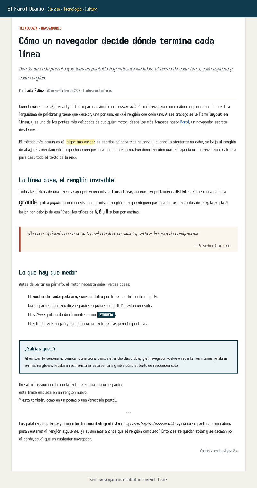
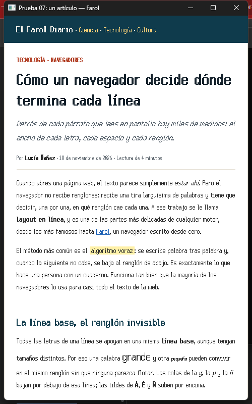
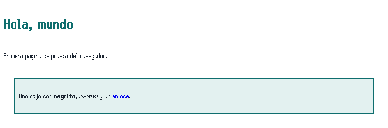

# Bitácora — Fase 8: layout en línea

Fecha: 2026-11-18. Estado: cerrada.

## Qué se construyó

- `src/layout/en_linea/piezas.rs`: recorre los nodos en línea de cada caja anónima y los aplana en
  una cinta de piezas (palabra, espacio, ` `, abre y cierra elemento), colapsando los espacios
  como en HTML, también entre nodos distintos. El espacio duro (`&nbsp;`, U+00A0) no colapsa.
- `src/layout/en_linea/lineas.rs`: reparte la cinta en renglones con **partición voraz** (decisión
  8.1), quita el espacio del final de cada renglón, calcula el alto de cada renglón y su **línea
  base** común, y aplica `text-align` (izquierda, centro, derecha). Cada caja anónima guarda sus
  renglones (`Linea`) con sus pedazos de texto (`Fragmento`) en coordenadas de página, y mide de
  alto la suma de sus renglones. Reemplaza la estimación de la fase 5.
- Los elementos en línea (`span`, `a`, `.boton`) ocupan su margen, borde y relleno a los lados, y
  pintan su fondo y su borde en cada renglón donde aparecen. Si se parten entre dos renglones, el
  borde izquierdo va solo en el primer pedazo y el derecho solo en el último.
- `src/pintado/en_linea.rs` y `Orden::Texto`: la display list ahora escribe texto y dibuja el
  subrayado de los enlaces.
- `NodoEstilado::salto_de_linea`: el estilo marca los ` ` para que el layout corte ahí.
- `farol --layout` muestra cada renglón: su `y`, su alto, su línea base y sus fragmentos.
- `pruebas/07-articulo.html`: un artículo completo para lucir el navegador.
- 23 pruebas automáticas nuevas; se retiraron las 3 que medían la estimación de la fase 5 (198 en total).

## Hito

`farol pruebas/07-articulo.html` abre el artículo con su texto: títulos grandes en negrita,
cursivas, enlaces subrayados, un resaltado con fondo, una etiqueta con borde, una cita con el
autor alineado a la derecha, una lista, un recuadro y un ` ` que corta la línea. Al angostar
la ventana a 500 px, el mismo texto se reparte en más renglones:

Y `farol --render pruebas/01-hola.html hola.bmp` ya tiene su texto (en la fase 6 eran cajas
vacías):

## Conceptos nuevos

- **Cómo se decide dónde termina un renglón.** El navegador no recibe renglones: recibe una
  tira de palabras. Haz el ejercicio con un cuaderno: escribes una palabra, mides con el ojo si
  la siguiente cabe en lo que queda del renglón; si cabe, la escribes; si no, bajas. Eso es la
  **partición voraz** ("voraz" porque toma lo que puede *ahora*, sin pensar en los renglones de
  más abajo). Es lo que hace Word, y lo que hacen los navegadores en casi todo el texto. TeX
  (el programa con el que se escriben los libros de matemáticas) mira el párrafo entero y busca
  el reparto más parejo; es más bonito y mucho más caro. En Farol, "medir con el ojo" es sumar
  el ancho de cada letra de la palabra con la fuente de la fase 7.
- **La unidad irrompible.** Solo se puede bajar de renglón en un espacio. Por eso
  `muy<b>bueno</b>` es un solo bloque aunque cambie de letra en el medio: no hay dónde cortarlo.
  Una palabra más ancha que el renglón entero se escribe sola y se sale por el borde, como en
  Chrome (`electroencefalografista` en un renglón de 50 px).
- **Colapsar espacios.** En tu HTML, el párrafo tiene saltos de línea y sangría para que tú lo
  leas cómodo; el navegador los convierte en un espacio. Diez espacios, un tabulador y un salto
  de línea seguidos valen **un** espacio, aunque estén repartidos entre etiquetas
  (`<b>a </b> <i>b</i>` tiene un solo espacio). Al principio y al final de cada renglón, el
  espacio desaparece: nadie quiere el texto corrido medio carácter. La excepción es `&nbsp;`, el
  "espacio duro", que justamente sirve para pegar dos palabras que no deben separarse (`10 km`).
- **La línea base: el renglón del cuaderno.** En un cuaderno de caligrafía todas las letras se
  apoyan en el mismo renglón impreso, y las colas de la g y la p cuelgan por debajo. Si en una
  misma línea escribes una palabra de 26 px y otra de 12 px, las dos se apoyan en ese renglón:
  por eso no parece que una flota. Para lograrlo, cada pedazo de texto dice cuánto lugar necesita
  *arriba* de la base (su letra más el medio interlineado) y cuánto *abajo* (la cola más la otra
  mitad). El renglón mide lo más que alguien pide arriba más lo más que alguien pide abajo, y la
  base queda donde se juntan. Un renglón con una palabra grande sale más alto que los demás,
  como en el artículo con la palabra "grande".
- **El puntal.** Cada renglón cuenta además con un pedazo invisible del tamaño de la letra del
  párrafo. Así un renglón que solo tiene letra chica igual mide el `line-height` del párrafo y
  los renglones no se amontonan. CSS lo llama *strut*.
- **Por qué al achicar la ventana todo se recalcula.** Al arrastrar el borde de la ventana no
  cambia ni una letra: cambia el ancho que hay para escribir. El DOM y los estilos se calculan
  una sola vez al abrir; el layout se rehace en cada repintado con el ancho nuevo, y las mismas
  palabras caen en otros renglones. Si un párrafo pasa de 4 a 6 renglones, se hace más alto,
  empuja hacia abajo todo lo que viene después y cambia el alto de la página entera. Es el
  *reflow* que los desarrolladores web tratan de evitar en las animaciones: ahora se ve por qué
  cuesta, cada palabra se vuelve a medir.
- **Un elemento en línea partido en dos.** Un `` con fondo que empieza al final de un
  renglón y termina en el siguiente no es un rectángulo: son dos pedazos. Farol guarda un pedazo
  por renglón y pinta el borde izquierdo solo en el primero y el derecho solo en el último, como
  si cortaras una cinta con tijera (en CSS: `box-decoration-break: slice`).
- **Referencias con tiempo de vida en Rust (`&'a Estilo`).** Cada fragmento de texto necesita el
  estilo de su nodo (color, tamaño, negrita). En vez de copiarlo, guarda una *referencia*: una
  dirección de memoria que apunta al estilo que ya está en el árbol estilado, como guardar el
  `id` de una fila en vez de copiar la fila entera. El `'a` es la promesa que el compilador
  verifica: el árbol estilado vive al menos tanto como los fragmentos que apuntan a él. Si alguien
  borrara el árbol antes, el programa no compilaría.

## Decisiones

- 8.1 (partición voraz), delegada a Claude; no entró ninguna dependencia nueva.
- Detalles internos (documentados en `docs/ARQUITECTURA.md`): las líneas se guardan en
  `Caja::lineas`; los fragmentos apuntan al estilo de su nodo con una referencia; los estilos
  marcan el ` ` con `NodoEstilado::salto_de_linea` porque el layout no ve el DOM; el alto de
  cada renglón usa el modelo de CSS (lo que piden arriba y abajo de la base) en vez del simple
  "mayor `line-height`", porque así coincide con Chrome cuando se mezclan tamaños.

## Lo que salió mal o quedó pendiente

- `char::is_whitespace` de Rust dice que el espacio duro U+00A0 *es* un espacio: con él,
  `&nbsp;` habría colapsado y partido renglones. La lista de espacios que colapsan va a mano,
  como la define CSS.
- Dos pruebas tenían la cuenta mal, no el código: una olvidaba los 16 px de margen del `
`; la
  otra esperaba 30 px en un renglón con `line-height: 30px` y letra de 8 px, pero CSS da 32,5 (la
  letra chica hereda los 30 px fijos y pide su medio interlineado alrededor de *su* base, que
  queda más abajo). Farol coincidía con CSS; se corrigió la prueba.
- La flecha `→` del artículo y el `×` de `05-cascada.html` salen como tofu (la fuente no los
  tiene; deuda de la fase 7). En el artículo se cambió la flecha por `»`.
- Comparando con Chrome, lo más visible que queda: la letra (pixelada, sin suavizado y una sola
  familia, así que los renglones se parten en otras palabras), el espacio vertical de más por no
  colapsar márgenes, y los `<li>` sin viñeta.
- Deudas nuevas en `DECISIONES.md`: solo `vertical-align: baseline`, sin partir dentro de
  palabras ni después de `-`, fondos en línea algo más bajos que en Chrome, subrayado simple,
  texto sin alfa ni `letter-spacing`, `inline-block` como en línea. Resueltas: la estimación de
  alto de la fase 5 y los fondos y bordes en línea de la fase 6.
- Para probar: abre `farol pruebas/07-articulo.html` y angosta la ventana despacio: mira cómo
  "electroencefalografista" salta entera de renglón. O corre
  `farol --layout pruebas/01-hola.html 300` y compara los renglones con los de 800. O cambia en
  el artículo `text-align: right` de `.cita-autor` por `center`.
